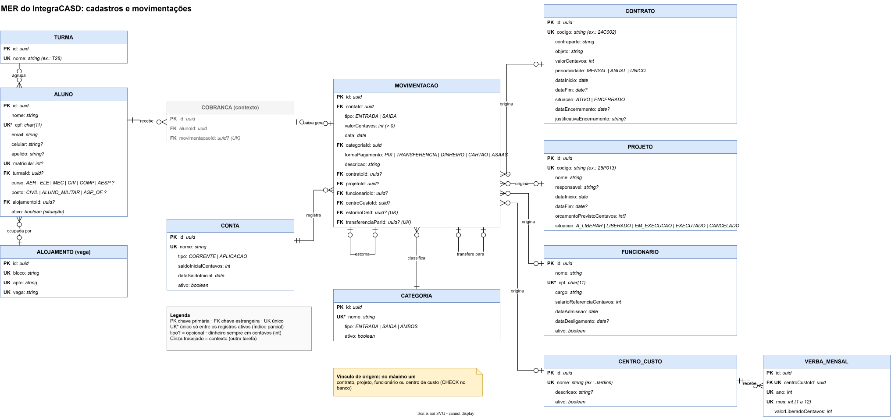

# MER: parte financeira (movimentações, contratos, projetos)

**Situação: validado em 26/10/2026**, com as decisões abaixo aplicadas conforme a recomendação.

Fontes: a planilha do Fundo de Manutenção do H8 (2026) e o documento de requisitos v1.1
([Cadastros.RF002], [Cadastros.RF004], [Cadastros.RF005], [Movimentações.RF001],
[Movimentações.RF002], [Administração.RF002]). Aluno, turma e alojamento seguem o modelo
combinado pela equipe em 21/10 ([Cadastros.RF001]). `COBRANCA` é *contexto*: pertence à tarefa
de Cobranças e aparece só para mostrar onde ela se liga.

## Diagrama

Fonte editável: [`mer-financeiro.drawio`](mer-financeiro.drawio). Ao alterar, exporte de novo o `.svg`.

## Tabelas de apoio (fora do diagrama)

Ficam fora do desenho para ele continuar legível; o `schema.prisma` é a referência completa.

| Tabela | Para quê | Detalhe |
| --- | --- | --- |
| `usuarios`, `sessoes` | acesso ao sistema ([Administração.RF001]) | perfis administrativo e diretoria |
| `registros_auditoria` | trilha de auditoria ([Segurança.NF006]) | só de inclusão; o banco recusa `UPDATE` e `DELETE` (ADR-0004) |
| `parametros_cobranca` | parâmetros da mensalidade ([Administração.RF003]) | uma linha por alteração, nunca alterada; a vigente é a mais recente |
| `eventos_webhook` | eventos recebidos do Asaas ([Desempenho.NF001]) | id do Asaas único, para a idempotência |

## Regras que o diagrama não mostra

1. **No máximo um vínculo de origem por movimentação:** contrato, projeto, funcionário ou centro
   de custo. No banco isso vira um `CHECK`; no backend, uma validação com mensagem.
2. **Uma movimentação só aceita uma categoria compatível com o seu tipo:** uma `ENTRADA` não
   recebe categoria `SAIDA`, e vice-versa.
3. **O estorno é uma movimentação nova**, de tipo oposto e mesmo valor, com origem `ESTORNO`,
   `motivoEstorno` preenchido e `estornoDeId` apontando para a original. Como o campo é `UNIQUE`,
   uma movimentação só pode ser estornada uma vez. Nada é apagado. Só movimentações de origem
   `MANUAL` podem ser estornadas: as que vêm de cobrança são corrigidas pela cobrança
   ([Movimentações.RF002], fluxo E1).
4. **A transferência entre contas (aplicar ou resgatar) é um par de movimentações** com o mesmo
   valor e tipos opostos, em contas diferentes, ligadas por `transferenciaParId`. Ela muda o saldo
   de cada conta, mas fica de fora do resultado do CASD (não é receita nem despesa). É isso que a
   planilha faz à mão no "Resumo Fundo de Manutenção".
5. **Rendimento da aplicação** é uma `ENTRADA` na conta `APLICACAO` com a categoria "Rendimento".
   Não precisa de tabela própria.
6. **Verba mensal:** só pode haver uma por centro de custo e mês (`UNIQUE (centroCustoId, ano, mes)`).
7. **Código de contrato e projeto** segue o formato da planilha (ano com 2 dígitos + `C`/`P` +
   sequência de 3 dígitos) e é gerado pelo backend.
8. **Aluno:** o CPF é único só entre os alunos ativos (índice parcial, como já está no schema).
   Assim, um cadastro inativo não impede recadastrar a mesma pessoa.
9. **Alojamento:** cada registro é uma vaga, com `UNIQUE (bloco, apto, vaga)`.

## Alunos: o que muda em relação ao schema atual

Estes são os campos combinados em 21/10 ([Cadastros.RF001]). Comparado ao `schema.prisma` da `main`:

- **Entram:** `apelido`, além de `alojamentoId` (FK para a vaga) no lugar do texto livre.
- **Saem:** `situacao` (o enum `MATRICULADO | TRANCADO | …`), que é substituído por `ativo`,
  e as colunas de texto `alojamento`, `apto` e `vaga`. A remoção fica para um passo posterior,
  depois que a carga inicial preencher os campos novos (expandir e depois contrair). Até lá, no
  Prisma, a coluna de texto `alojamento` se chama `alojamentoTexto`, para liberar o nome
  `alojamento` para a relação com a vaga.
- **Continuam iguais:** `nome`, `cpf`, `email`, `celular`, `matricula`, `turmaId`, `curso`,
  `posto` e `ativo`.

Ainda em aberto, sem decisão: como tratar bolsistas e isentos, o histórico de boletos, como
mapear Trancado e Intercâmbio para `ativo`, e o curso "1º/2º Fund" da planilha, que não existe no
enum.

## O que é calculado, e não guardado

| Valor | Como se calcula |
| --- | --- |
| Saldo de uma conta | saldo inicial + entradas − saídas da conta até a data |
| Resultado do mês | entradas − saídas, sem transferências |
| Total pago num contrato ou projeto | soma das saídas vinculadas, menos os estornos |
| Restante do projeto | orçamento previsto − total pago |
| Saldo da verba do mês | verba liberada − saídas do centro de custo no mês |
| Gasto por categoria e % sobre o total | agrupamento das saídas do período |
| Adimplência | consulta sobre as cobranças (deixa de ser digitada) |

## Da planilha para o modelo

| Na planilha | No modelo |
| --- | --- |
| Abas Janeiro…Dezembro, tabela Entradas | `MOVIMENTACAO` tipo `ENTRADA` na conta corrente |
| Abas Janeiro…Dezembro, tabela Saídas | `MOVIMENTACAO` tipo `SAIDA`; a projetização vira o vínculo de origem |
| Aba Investimentos | movimentações na conta `APLICACAO` (rendimento, aporte, retirada) |
| Projetização `25P013 - …` / `23Z005 - …` | `PROJETO` (os dois formatos viram a mesma entidade) |
| Projetização `24C002 - …` | `CONTRATO` |
| Projetização `Z - Jardins` etc. | `CENTRO_CUSTO` |
| Projetização `A - Funcionárias` | vínculo com `FUNCIONARIO` |
| Projetização `A - Impostos`, `A - Taxas Bancárias`, `A - Taxa AEITA`… | só `CATEGORIA` |
| Valor liberado (aba Zeladoria e Administrativo) | `VERBA_MENSAL` |
| Saldos iniciais (Resumo Mensal C8 e C13) | `CONTA.saldoInicialCentavos` |
| Resumo Mensal, Prestações, Gráficos, Resumo de Projetos | consultas (nada guardado) |

## Decisões

Tomadas em 26/10/2026. Os itens 1, 2 e 3 vão **além do documento de requisitos v1.1** e precisam
de uma nota no documento. O mesmo vale para o responsável opcional do projeto (o [Cadastros.RF005]
ainda o trata como obrigatório) e para os itens 5 e 6, que diferem do texto dos requisitos.

1. **`CONTA` (corrente e aplicação):** incluída. Sem ela, o saldo do fundo e os investimentos não
   fecham com a planilha.
2. **`CENTRO_CUSTO` e `VERBA_MENSAL`:** incluídas. Reproduzem o controle de verbas da zeladoria.
3. **Transferência como par de movimentações** (regra 4). A alternativa, uma categoria marcada como
   "não entra no resultado", não liga as duas pernas.
4. **Centros administrativos (`A - …`) viram categorias**, e "Funcionárias" vira vínculo com
   funcionário.
5. **Situação do projeto:** os 5 status da planilha (`A_LIBERAR`, `LIBERADO`, `EM_EXECUCAO`,
   `EXECUTADO`, `CANCELADO`). A tela agrupa os três primeiros como "em andamento" e os dois últimos
   como "encerrados".
6. **Periodicidade do contrato:** `MENSAL | ANUAL | POR_DEMANDA | UNICA`, a união da planilha
   (contrato anual) com a tela (por demanda).
7. **Origem da movimentação e motivo do estorno:** incluídos, porque o [Movimentações.RF002] e a
   tela de Movimentações precisam deles.
8. **Código `24C002` / `25P013`:** mantido, para não perder a referência da planilha.
9. **Histórico de boletos na carga inicial:** importado como movimentações sem cobrança
   vinculada, porque na planilha as entradas são totais por dia, sem aluno.
10. **Contas a pagar** (aba A Pagar): fora do MVP.
11. **Vaga:** no máximo um aluno ativo por vaga (índice parcial). Os inativos guardam a vaga antiga.
12. **Exclusão de categoria:** categoria que nunca foi usada pode ser excluída (por exemplo, criada por
    engano). Com movimentações, só pode ser inativada. É a única exceção à regra "nada é excluído
    fisicamente" e diverge do [Administração.RF002] (decisão de 26/10/2026).
