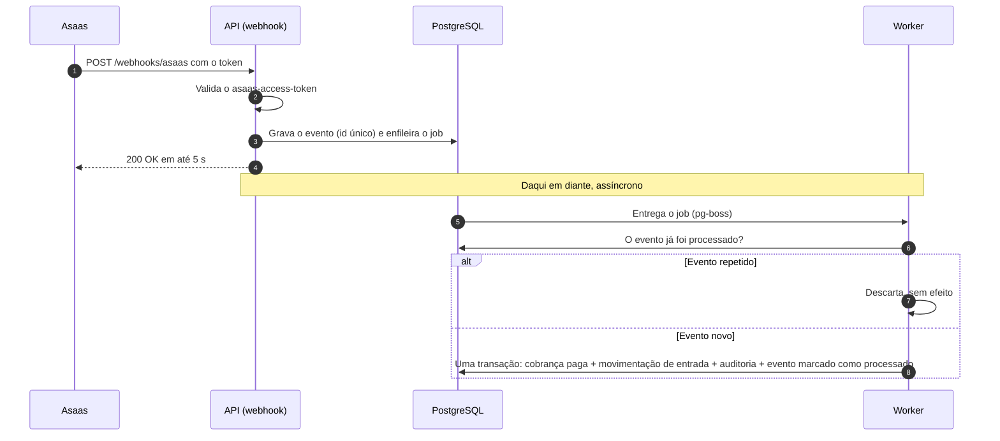

# Sequência: conciliação de um pagamento via webhook

O Asaas recebe resposta antes do processamento; a baixa acontece numa única transação. Detalhes no [ADR-0002](../adr/0002-postgresql-banco-e-fila.md).

| Passo | Garante | Requisito |
| --- | --- | --- |
| 2 | Ninguém além do Asaas altera dados financeiros | [Segurança.NF002] |
| 4 | O Asaas não conta falhas nem interrompe a fila | [Desempenho.NF001], [Confiabilidade.NF001] |
| 6 e 7 | Nenhuma entrada duplicada | [Confiabilidade.NF003] |
| 8 | Cobrança paga sempre tem movimentação | [Confiabilidade.NF004] |

Se a transação do passo 8 falhar, nada é gravado e o pg-boss tenta o job de novo; o evento já está salvo desde o passo 3.
